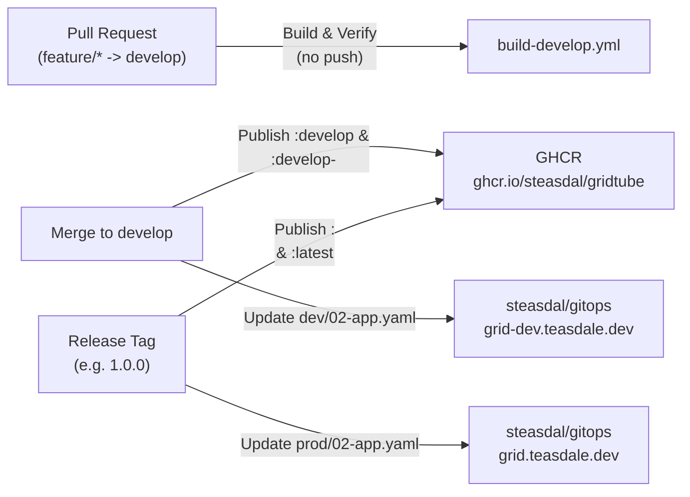

# GridTube

A modern, self-hosted Single Page Application (SPA) for streaming up to four YouTube live feeds simultaneously in a full-viewport 2×2 grid with zero wasted screen space.

## Features

- **100% Viewport 2×2 Video Wall**: In grid view, the four stream panes occupy `100% × 100dvh` with a tucked top-left `Menu ▾` hover drawer that stays out of the way of YouTube's built-in player controls.
- **Per-Feed Audio Controls**: Configure a default Mute/Unmute state and `0–100%` volume level for each of the four panes in the Add/Edit dialog, applied automatically via the YouTube IFrame API on grid load and updated live when edited from within a playing grid.
- **Partial Grid Support**: Any of the 4 feed URLs can be left blank; unconfigured slots render a clean empty box with a one-click button to add a feed URL later.
- **Persistent Volume Storage**: Saved grids are stored atomically as JSON in `DATA_DIR` (`/data/grids.json` by default in Docker/Kubernetes).
- **Pre-seeded Example**: Automatically seeds the `choo-choos` railroad crossing grid on first start if `grids.json` does not exist yet.

---

## Quick Start

### 1. Local Node.js

```bash
node server.js
# Open http://localhost:8080
```

### 2. Docker & Docker Compose

```bash
# Pull and start from GitHub Container Registry with a local ./data volume mounted to /data
docker compose up -d

# Or run the develop tag:
IMAGE_TAG=develop docker compose up -d

# Or with docker run directly:
docker run -d --name gridtube -p 8080:8080 -v "$(pwd)/data:/data" ghcr.io/steasdal/gridtube:latest
```

---

## CI/CD Pipeline & GitOps Deployment

GridTube uses a **Git-Flow** branching strategy paired with GitHub Actions multi-architecture (`linux/amd64`, `linux/arm64`) builds and automated **Flux CD GitOps** image promotion into [`steasdal/gitops`](https://github.com/steasdal/gitops).



### Workflows Overview

| Workflow | Trigger | Image Tags Published | GitOps Target Updated (`steasdal/gitops`) | Live Route |
| :--- | :--- | :--- | :--- | :--- |
| **[build-develop.yml](.github/workflows/build-develop.yml)** | `pull_request` to `develop` / `main` | *None* (runs syntax checks & multi-arch build verification only) | *None* | — |
| **[build-develop.yml](.github/workflows/build-develop.yml)** | `push` to `develop` (or manual dispatch) | `ghcr.io/steasdal/gridtube:develop`<br>`ghcr.io/steasdal/gridtube:develop-<sha>` | `apps/gridtube/dev/02-app.yaml` (`:develop-<sha>`) | `https://grid-dev.teasdale.dev` |
| **[build-release.yml](.github/workflows/build-release.yml)** | `push` tag `X.Y.Z` or `vX.Y.Z` | `ghcr.io/steasdal/gridtube:<version>`<br>`ghcr.io/steasdal/gridtube:latest` | `apps/gridtube/prod/02-app.yaml` (`:<version>`) | `https://grid.teasdale.dev` |

- **Automatic Branch Cleanup**: Merging a pull request on GitHub automatically deletes the head `feature/*` branch.
- **Cross-Repository Authentication**: Both workflows authenticate to `steasdal/gitops` using an Ed25519 SSH deploy key stored in the `GITOPS_DEPLOY_KEY` repository secret.

---

## Development & Release Workflow (`git-flow`)

### 1. Working on a Feature (`feature/*` → `develop`)

1. **Start a feature branch from `develop`**:
   ```bash
   git flow feature start <feature-name>
   # Or with standard git:
   # git checkout develop && git pull origin develop && git checkout -b feature/<feature-name>
   ```
2. **Commit and push your changes**:
   ```bash
   git add .
   git commit -m "feat: describe your change"
   git push -u origin feature/<feature-name>
   ```
3. **Open a Pull Request targeting `develop`**:
   - Open a PR on GitHub with **base branch set to `develop`** (not `main`), or via the GitHub CLI:
     ```bash
     gh pr create --base develop --head feature/<feature-name> --fill
     ```
   - `build-develop.yml` will automatically run on the PR to validate JavaScript syntax and verify the multi-arch Docker build.
4. **Merge the PR**:
   - Once merged into `develop`, GitHub automatically deletes the remote `feature/<feature-name>` branch, builds and pushes `:develop` and `:develop-<sha>` to GHCR, and updates `apps/gridtube/dev/02-app.yaml` in `steasdal/gitops`.

---

### 2. Starting and Finishing a Release (`release/*` → `main` & `develop`)

When `develop` is tested on `https://grid-dev.teasdale.dev` and ready to promote to production (`https://grid.teasdale.dev`):

#### Using `git-flow` CLI

1. **Ensure local `develop` and `main` are up to date**:
   ```bash
   git checkout main && git pull origin main
   git checkout develop && git pull origin develop
   ```
2. **Start the release** (e.g. `1.1.0`):
   ```bash
   git flow release start 1.1.0
   ```
3. **(Optional) Bump version in `package.json` and commit**:
   ```bash
   npm version 1.1.0 --no-git-tag-version
   git commit -am "chore(release): 1.1.0"
   ```
4. **Finish the release**:
   ```bash
   git flow release finish 1.1.0
   ```
   *(This merges `release/1.1.0` into `main`, tags `1.1.0`, merges back into `develop`, and deletes the local release branch).*
5. **Push `main`, `develop`, and the new release tag to GitHub**:
   ```bash
   git push origin main develop --tags
   ```

#### Triggered Automation on Release Push
Pushing the `1.1.0` tag triggers **[build-release.yml](.github/workflows/build-release.yml)**, which:
1. Builds and pushes the multi-arch image tagged `ghcr.io/steasdal/gridtube:1.1.0` and `ghcr.io/steasdal/gridtube:latest`.
2. Commits and pushes the updated image tag (`ghcr.io/steasdal/gridtube:1.1.0`) to `apps/gridtube/prod/02-app.yaml` in `steasdal/gitops`.
3. Flux CD reconciles the change onto the cluster and rolls out the new release to `https://grid.teasdale.dev`.
